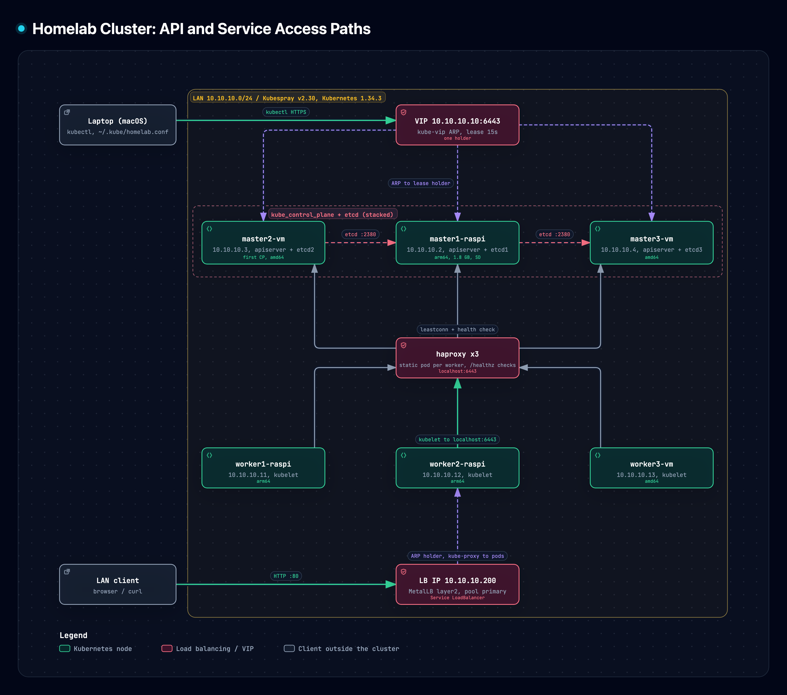
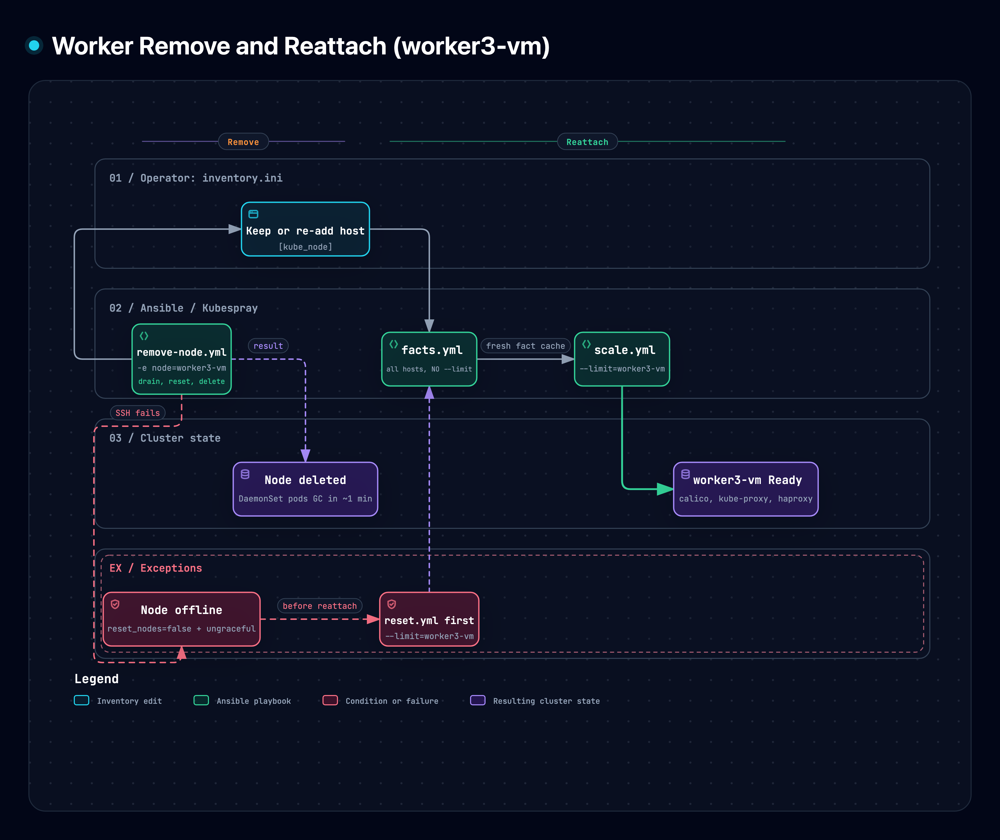
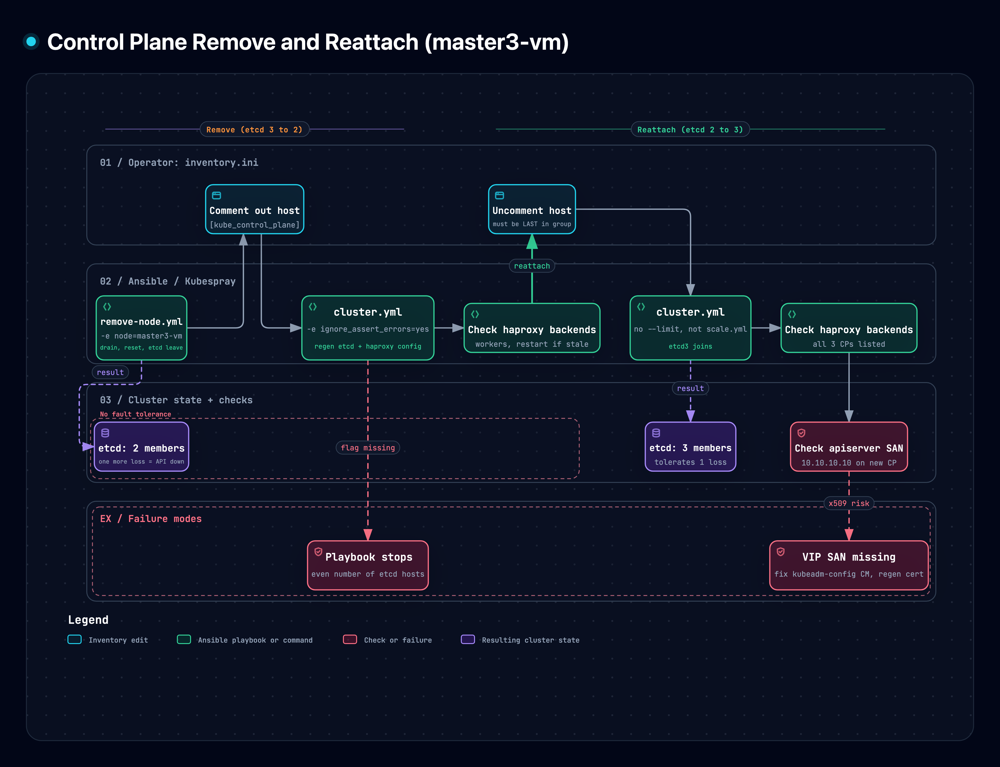
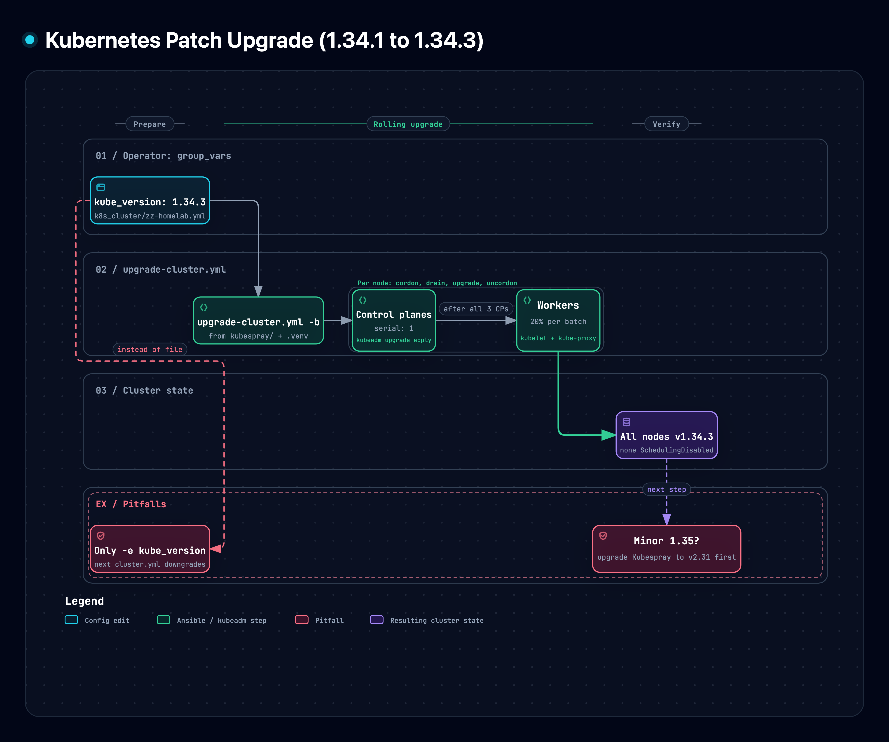

# Homelab Kubernetes cluster (Kubespray v2.30.0)

Runbook for a 6-node HA cluster: 3 control planes + 3 workers, on mixed hardware
(Raspberry Pi arm64 + VirtualBox VMs amd64), deployed and operated with Kubespray.
It covers the configuration as it runs today, the five procedures that were
exercised end to end (init, remove node, reattach worker, reattach control plane,
upgrade), and the problems found along the way.

Diagrams (in `docs/img/`):

| Diagram | Shows |
|---|---|
| [Cluster architecture](docs/img/architecture.png) | Nodes, stacked etcd, the two API failover paths (VIP for the laptop, haproxy for workers), and the MetalLB Service IP |
| [Control plane remove and reattach](docs/img/control-plane-remove-reattach.png) | Section 4.5 + 4.6: playbook order, the 2-member etcd window, and the VIP SAN check |
| [Worker remove and reattach](docs/img/worker-remove-reattach.png) | Section 4.3 + 4.4, including the offline-node branch |
| [Kubernetes patch upgrade](docs/img/kubernetes-upgrade.png) | Section 4.7: rolling order and the `-e kube_version` pitfall |

Kubespray itself is the `kubespray/` git submodule, pinned to the release tag in use. Playbooks
run from inside the submodule, so Kubespray's own `ansible.cfg` is picked up, with the inventory
in this repository:

```bash
cd kubespray                      # the submodule, not the repository root
source ../.venv/bin/activate
INV=../inventory/homelab/inventory.ini
```

---

## 1. Topology

| Node            | IP           | Role                  | Arch    | Notes                                   |
|-----------------|--------------|-----------------------|---------|-----------------------------------------|
| `master2-vm`    | 10.10.10.3   | control plane + etcd2 | x86_64  | **First** CP in inventory (kubeadm init node) |
| `master1-raspi` | 10.10.10.2   | control plane + etcd1 | aarch64 | ~1.8 GB RAM, root on SD card            |
| `master3-vm`    | 10.10.10.4   | control plane + etcd3 | x86_64  |                                         |
| `worker1-raspi` | 10.10.10.11  | worker                | aarch64 |                                         |
| `worker2-raspi` | 10.10.10.12  | worker                | aarch64 |                                         |
| `worker3-vm`    | 10.10.10.13  | worker                | x86_64  |                                         |
| VIP             | 10.10.10.10  | API server VIP        | —       | kube-vip, ARP mode, held by one CP      |

| Component        | Version / choice                          |
|------------------|-------------------------------------------|
| Kubespray        | v2.30.0                                   |
| Kubernetes       | 1.34.3 (initially deployed as 1.34.1)     |
| OS               | Ubuntu Server 24.04.5 LTS                 |
| Container runtime| containerd 2.2.1                          |
| CNI              | Calico 3.30 (VXLAN backend)               |
| kube-proxy       | IPVS, `strictARP: true`                   |
| etcd             | Stacked on the control planes (host deployment) |
| Service / Pod CIDR | 10.233.0.0/18 / 10.233.64.0/18          |

### How traffic reaches the API servers and Services

```
 laptop (kubectl) ──► 10.10.10.10:6443 (VIP, kube-vip) ──► whichever CP holds the lease
 worker kubelet   ──► localhost:6443 (haproxy static pod) ──► all 3 CPs (leastconn + active health check)
 CP kubelet       ──► 127.0.0.1:6443 (its own kube-apiserver)
 LAN client       ──► 10.10.10.200 (MetalLB L2, one speaker answers ARP) ──► kube-proxy ──► Service pods
```



Two layers on purpose:

- **Inside the cluster** nodes use Kubespray's node-local haproxy (`loadbalancer_apiserver_localhost`).
  This needs no VIP and keeps working if kube-vip misbehaves.
- **Outside the cluster** (kubectl on the laptop) uses the kube-vip VIP. `loadbalancer_apiserver`
  is deliberately **not** set: setting it would repoint every kubelet's kubeconfig at the VIP and
  make the whole cluster depend on kube-vip.

---

## 2. Files

```
.
├── README.md                             # this runbook
├── docs/img/                             # diagrams embedded in this README
├── kubespray/                            # git submodule: kubernetes-sigs/kubespray @ v2.30.0
└── inventory/homelab/
    ├── inventory.ini                     # hosts, groups, per-host kube_vip_interface
    ├── prep-raspi.yml                    # Raspberry Pi preparation playbook (run once before init)
    ├── devops-vm-agent.yml               # devops-vm-agent on every node (section 4.11)
    ├── containerd-godebug.yml            # containerd without post-quantum TLS (section 6.8)
    ├── templates/devops-vm-agent.conf.j2 # its /etc/devops-vm-agent.conf
    ├── group_vars/
    │   ├── all/z-homelab.yml             # node-local haproxy LB, download settings, unattended-upgrades
    │   ├── k8s_cluster/z-homelab.yml     # kube_version, CNI, CIDRs, kube-vip, MetalLB, local-path, apiserver goaway-chance
    │   └── k8s_cluster/devops-vm-agent.yml # devops-vm-agent version, URL, restart allowlist, Secret
    ├── artifacts/admin.conf              # generated by Kubespray (kubeconfig_localhost), gitignored
    └── credentials/                      # generated by Kubespray (and devops-vm-agent tokens), gitignored
```

The rest of `group_vars/` is the untouched copy of `kubespray/inventory/sample` from v2.30.0. All homelab changes live in
the `z-homelab.yml` files. Ansible loads the files in a `group_vars/<group>/` directory in
alphabetical order and the last one wins, so the `z-` prefix makes these overrides beat the sample
files without editing them. Keep the prefix: as `homelab.yml` the file would sort before
`k8s-cluster.yml`, and that file's `kube_proxy_strict_arp: false` and `auto_renew_certificates: false`
would silently win.

> **Secrets:** `artifacts/admin.conf` is a cluster-admin credential, and `credentials/` holds
> generated secrets. Do not commit them or share them.

### Key settings and why

| Setting | Value | Why |
|---|---|---|
| `kube_version` | `1.34.3` | No `v` prefix (required since Kubespray v2.28). Set it **in the file**, never only with `-e`, otherwise the next `cluster.yml` run tries to downgrade. |
| `loadbalancer_apiserver_localhost` / `_type` | `true` / `haproxy` | Node-side HA to the API servers without an external LB. haproxy actively health-checks each API server (`GET /healthz` every 15 s) and drops a dead one; nginx (the default, used until 4.8) only notices a dead backend when a connection to it fails. |
| `download_run_once` / `download_localhost` | `false` | Mixed arch: a single cached download would only serve one architecture. |
| `ubuntu_stop_unattended_upgrades` | `true` | Keep kernel/containerd from changing underneath the cluster. |
| `kube_vip_enabled`, `kube_vip_controlplane_enabled`, `kube_vip_arp_enabled` | `true` | VIP for external API access. |
| `kube_vip_address` | `10.10.10.10` | Unused LAN IP, outside the DHCP range. |
| `kube_vip_interface` (per host) | `eth0` on the Pi, `enp0s3` on the VMs | Interface names differ per hardware, so it is set per host in `inventory.ini`. |
| `kube_proxy_strict_arp` | `true` | Kubespray refuses kube-vip ARP mode with IPVS without it. |
| `supplementary_addresses_in_ssl_keys` | `[10.10.10.10]` | Puts the VIP in the API server certificate SANs. |
| `kube_vip_leaseduration` / `renewdeadline` / `retryperiod` | `15` / `10` / `2` | The defaults (5/3/1) are too tight for an API server backed by etcd on a Pi: lease renewals time out, kube-vip restarts and the VIP flaps. Cost: VIP failover takes ~15 s. |
| `metallb_enabled`, `metallb_config` | pool `primary` = `10.10.10.200/32`, layer2 | IP for Services of type `LoadBalancer`. kube-vip only holds the control plane VIP (`kube_vip_services_enabled` stays `false`), so the two never answer ARP for the same IP. `10.10.10.100` was rejected: another device already answers ARP for it, and it sits in the DHCP range. |
| `local_path_provisioner_enabled` | `true` | Default StorageClass `local-path` for PVCs (Teleport's auth backend). Data lives under `/opt/local-path-provisioner/` on the node that first used the PVC. |
| `kubeconfig_localhost` | `true` | Writes `artifacts/admin.conf` on the Ansible host. |
| `auto_renew_certificates` | `true` | Monthly kubeadm cert renewal via systemd timer. |

---

## 3. Prerequisites

### Ansible control host (macOS)

Clone with the submodule:

```bash
git clone --recurse-submodules <this-repo-url> homelab-k8s
# or, in an existing clone:
git submodule update --init
```

Kubespray v2.30 requires ansible-core `>= 2.17.3, < 2.18.0`. The Homebrew Ansible on this Mac
(core 2.12.5) is too old and fails with errors such as
`couldn't resolve module/action 'ansible.builtin.systemd_service'`, so use the pinned virtualenv,
created at the repository root from the submodule's requirements:

```bash
python3 -m venv .venv
.venv/bin/pip install -U pip
.venv/bin/pip install -r kubespray/requirements.txt     # ansible 10.7.0 -> ansible-core 2.17.x
```

Alternative: the official image `quay.io/kubespray/kubespray:v2.30.0` (also ships `sshpass`).

### Nodes

- User `nvlannasik` with SSH key access (`ssh-copy-id`) and passwordless sudo.
- Raspberry Pi must run the **arm64** Ubuntu image.
- Raspberry Pi preparation (memory cgroup + `vxlan` module for Calico VXLAN). May reboot the Pis:

  ```bash
  ansible-playbook -i $INV ../inventory/homelab/prep-raspi.yml -b
  ```

- Connectivity check:

  ```bash
  ansible -i $INV all -m ping -o
  ```

---

## 4. Procedures

### 4.1 Init cluster

```bash
ansible-playbook -i $INV cluster.yml -b
```

`artifacts/admin.conf` points at the first control plane (`https://10.10.10.3:6443`). For laptop
use, keep a separate copy pointed at the VIP. The artifact is overwritten on every `cluster.yml`
run, so do not edit it in place:

```bash
cp ../inventory/homelab/artifacts/admin.conf ~/.kube/homelab.conf
kubectl --kubeconfig ~/.kube/homelab.conf config set-cluster cluster.local --server=https://10.10.10.10:6443
export KUBECONFIG=~/.kube/homelab.conf
kubectl get nodes -o wide
```

### 4.2 Enable the VIP on an already running cluster

kube-vip was added after the initial deploy. On a fresh cluster, the settings in
`k8s_cluster/z-homelab.yml` apply at init and only the `cluster.yml` run is needed.

1. Turn on `strictARP` in the live kube-proxy config. Kubespray only renders it into kubeadm
   config at init/upgrade, so an existing cluster needs it by hand:

   ```bash
   kubectl -n kube-system get cm kube-proxy -o yaml | sed 's/strictARP: false/strictARP: true/' | kubectl apply -f -
   kubectl -n kube-system rollout restart ds kube-proxy
   ```

2. Deploy kube-vip and regenerate the API server certificates with the VIP SAN:

   ```bash
   ansible-playbook -i $INV cluster.yml -b
   ```

3. Add the VIP to the `kubeadm-config` ConfigMap, so control planes that **join later** get it
   in their certificates (see [6.4](#64-new-control-plane-certificate-misses-the-vip-san)):

   ```bash
   kubectl -n kube-system edit cm kubeadm-config     # apiServer.certSANs: add "- 10.10.10.10"
   ```

4. If kubectl via the VIP reports `x509: certificate is valid for ... not 10.10.10.10`, restart
   kube-apiserver on each CP, **one at a time**:

   ```bash
   sudo crictl stop $(sudo crictl ps --name kube-apiserver -q)
   ```

To change only the kube-vip settings later (e.g. lease timings):

```bash
ansible-playbook -i $INV cluster.yml -b --tags kube-vip
```

### 4.3 Remove a worker (example: `worker3-vm`)



Flow for 4.3 + 4.4.

```bash
ansible-playbook -i $INV remove-node.yml -b -e node=worker3-vm      # answer "yes"
```

The playbook drains the node, resets it (`/etc/kubernetes`, `/var/lib/kubelet` removed;
kubelet and containerd stopped) and deletes it from the API. DaemonSet pods bound to the deleted
node linger for about a minute until the pod garbage collector removes them. That is expected.

Afterwards remove (or comment out) the host in `inventory.ini`. If it will be reattached right
away, it can stay.

If the node is offline, add `-e reset_nodes=false -e allow_ungraceful_removal=true`, and run
`reset.yml --limit=<node>` on it before reattaching it later.

### 4.4 Reattach a worker

Put the host back under `[kube_node]`, then:

```bash
ansible-playbook -i $INV facts.yml -b                              # all hosts, NO --limit
ansible-playbook -i $INV scale.yml -b --limit=worker3-vm
```

`facts.yml` refreshes the fact cache for every host. `scale.yml` with `--limit` needs those facts
(for example the control plane IPs used in the worker's haproxy config).

### 4.5 Remove a control plane (example: `master3-vm`)



Flow for 4.5 + 4.6.

Use a control plane that is **not** the first one in `[kube_control_plane]` (`master2-vm` is first).
Removing the first one needs a separate procedure, see [6.1](#61-the-first-control-plane-is-special).

1. Remove the node. This also removes its etcd member. If it held the VIP, the VIP moves to another
   CP within ~15 s, so kubectl may fail briefly.

   ```bash
   ansible-playbook -i $INV remove-node.yml -b -e node=master3-vm
   ```

2. Comment out the host in `[kube_control_plane]`.

3. Regenerate configuration on the remaining nodes (etcd config, haproxy backends). The
   override is **required**: with 2 etcd members Kubespray's "Stop if even number of etcd hosts"
   assertion stops the playbook.

   ```bash
   ansible-playbook -i $INV cluster.yml -b -e ignore_assert_errors=yes
   ```

4. Check that the workers' haproxy lists only the remaining control planes. The kubelet recreates
   the pod when `haproxy.cfg` changes (its checksum is an annotation in the static pod manifest).
   If a worker still lists the old backend, restart haproxy there:

   ```bash
   ansible -i $INV kube_node -b -m shell -a "grep '^  server' /etc/haproxy/haproxy.cfg"
   ansible -i $INV kube_node -b -m shell -a "crictl ps --name haproxy -q | xargs -r crictl stop"   # only if needed
   ```

5. Verify:

   ```bash
   kubectl get nodes
   ssh nvlannasik@10.10.10.3 'sudo etcdctl.sh member list -w table'     # 2 members
   ```

6. **Only if the removal is permanent:** on every remaining CP, remove the old endpoint from
   `--etcd-servers` in `/etc/kubernetes/manifests/kube-apiserver.yaml`. `cluster.yml` does not
   rewrite this on a running cluster. The kubelet restarts the API server when the file is saved.
   If the node will come back with the same IP, leave it as is.

> With 2 etcd members the cluster has **no fault tolerance**: losing one more control plane loses
> etcd quorum and the API goes down. Do not take other control planes down until the third one is back.

### 4.6 Reattach a control plane

1. Uncomment the host. It must be **last** in `[kube_control_plane]`: Kubespray does not support
   adding a control plane in the first position.

2. Run `cluster.yml` without `--limit`. `scale.yml` cannot add control planes. With 3 etcd hosts
   again, no assertion override is needed.

   ```bash
   ansible-playbook -i $INV cluster.yml -b
   ```

3. Check the workers' haproxy backends (same commands as in 4.5 step 4); all 3 CPs must be listed.

4. Verify:

   ```bash
   kubectl get nodes                                                     # master3-vm Ready
   ssh nvlannasik@10.10.10.3 'sudo etcdctl.sh member list -w table'      # 3 members
   ssh nvlannasik@10.10.10.3 'sudo etcdctl.sh endpoint health --cluster'
   for ip in 10.10.10.2 10.10.10.3 10.10.10.4; do
     printf "$ip: "; echo | openssl s_client -connect $ip:6443 2>/dev/null \
       | openssl x509 -noout -ext subjectAltName | grep -q 'IP Address:10.10.10.10' && echo ok || echo MISSING
   done
   ```

   If the new CP is `MISSING` the VIP SAN, see [6.4](#64-new-control-plane-certificate-misses-the-vip-san).

### 4.7 Upgrade Kubernetes (patch: 1.34.1 → 1.34.3)



1. Edit `kube_version: 1.34.3` in `group_vars/k8s_cluster/z-homelab.yml`.
2. Run:

   ```bash
   ansible-playbook -i $INV upgrade-cluster.yml -b
   ```

Control planes are upgraded one at a time (`serial: 1`), workers in batches of 20 %. Each node is
cordoned, drained, upgraded and uncordoned.

Verify:

```bash
kubectl get nodes                                                          # all v1.34.3, none SchedulingDisabled
kubectl -n kube-system get pods -o custom-columns='NAME:.metadata.name,IMG:.spec.containers[0].image' | grep kube-
kubectl -n kube-system get cm kubeadm-config -o jsonpath='{.data.ClusterConfiguration}' | grep kubernetesVersion
```

Kubespray v2.30.0 ships Kubernetes 1.32.0 – 1.34.3. A **minor** upgrade to 1.35 needs a newer
Kubespray (v2.31). Upgrade Kubespray one release at a time, then raise `kube_version`.

#### Upgrading Kubespray (the submodule)

```bash
git -C kubespray fetch --tags
git -C kubespray checkout v2.31.0                       # next release only, never skip one
.venv/bin/pip install -r kubespray/requirements.txt     # requirements change between releases
diff -r kubespray/inventory/sample/group_vars inventory/homelab/group_vars   # new/renamed sample vars
git add kubespray && git commit -m "Bump Kubespray to v2.31.0"
```

Then read the release notes for removed or renamed variables, run `upgrade-cluster.yml`, and only
afterwards raise `kube_version` for the minor upgrade. The diff shows the sample files that changed
upstream; homelab overrides stay in the `z-homelab.yml` files and are not touched by it.

### 4.8 Switch the node-local API load balancer from nginx to haproxy

Set `loadbalancer_apiserver_type: haproxy` in `group_vars/all/z-homelab.yml`. Kubespray's haproxy
task deletes `/etc/kubernetes/manifests/nginx-proxy.yml` and writes `haproxy.yml` plus
`/etc/haproxy/haproxy.cfg`, so the kubelet swaps the static pods by itself. Each worker loses
`localhost:6443` for a few seconds during the swap. Running pods are not affected; the kubelet and
kube-proxy reconnect.

1. Canary on one worker. `cluster.yml` (not `--tags haproxy`) is needed because the download role
   pulls the haproxy image first, and `facts.yml` first because of `--limit`:

   ```bash
   ansible-playbook -i $INV facts.yml -b
   ansible-playbook -i $INV cluster.yml -b --limit=worker3-vm
   ```

2. Check the canary:

   ```bash
   kubectl -n kube-system get pods -o wide | grep -E 'haproxy|nginx-proxy'   # haproxy-worker3-vm Running, no nginx-proxy-worker3-vm
   kubectl get node worker3-vm                                                 # stays Ready
   ssh nvlannasik@10.10.10.13 "sudo grep '^  server' /etc/haproxy/haproxy.cfg" # 3 control planes
   ssh nvlannasik@10.10.10.13 'curl -sk https://localhost:6443/healthz; echo'  # ok
   ```

3. Roll out to the remaining workers:

   ```bash
   ansible-playbook -i $INV cluster.yml -b --limit=kube_node
   ```

4. Optional cleanup: `/etc/nginx/nginx.conf` stays on the workers but nothing reads it:

   ```bash
   ansible -i $INV kube_node -b -m file -a "path=/etc/nginx state=absent"
   ```

Rollback: set the type back to `nginx` and run the same commands. The nginx task removes the
haproxy manifest in the same way.

### 4.9 MetalLB for LoadBalancer Services

Settings live in `group_vars/k8s_cluster/z-homelab.yml` (see the table in section 2). Before
choosing a pool address, make sure nothing answers ARP for it and that it is outside the
router's DHCP range:

```bash
ping -c1 -t1 10.10.10.200; arp -n 10.10.10.200      # expect "no entry" / incomplete
```

Install or update MetalLB and its pool. MetalLB is a cluster app, so this only touches the
first control plane and the API; nodes are not reconfigured:

```bash
ansible-playbook -i $INV cluster.yml -b --tags metallb
```

Verify with a throwaway Service:

```bash
kubectl -n metallb-system get pods -o wide                 # controller + one speaker per node
kubectl get ipaddresspools,l2advertisements -n metallb-system
kubectl create deployment lb-test --image=nginx
kubectl expose deployment lb-test --port=80 --type=LoadBalancer
kubectl get svc lb-test                                    # EXTERNAL-IP 10.10.10.200
curl -s http://10.10.10.200 | grep -i title                # from the laptop
kubectl delete svc,deployment lb-test
```

The pool holds one address, so only one `LoadBalancer` Service gets an IP at a time; the next
one stays `<pending>`. To give several Services the same IP on different ports, annotate each
with the same `metallb.universe.tf/allow-shared-ip: <key>`, or widen the pool to a range
(`10.10.10.200-10.10.10.210`).

In layer2 mode one speaker answers ARP for the IP, so all traffic enters through that node and
kube-proxy spreads it to the pods. If that node dies, another speaker takes over the IP.

### 4.10 Teleport, exposed through a Cloudflare Tunnel

Remote access to the cluster from outside the LAN at `https://teleport.annasik.cloud`, with no
port opened on the router. The app manifests (`values.yaml`, `cloudflared.yaml`,
`kube-admin-role.yaml`, and the gitignored `cloudflared-secret.yaml` with the tunnel token) are
kept **outside this repository**, in `~/riset/kubespray/homelab-apps/teleport/`; the commands
below refer to that folder as `$APPS`:

```bash
APPS=~/riset/kubespray/homelab-apps
```

```
tsh / browser ─HTTPS─► Cloudflare edge (teleport.annasik.cloud) ─tunnel─► cloudflared pods
   ─HTTPS, no TLS verify─► teleport-cluster proxy (ClusterIP :443) ─► auth + kubernetes_service ─► kube-apiserver
```

Why it is set up this way:

- **Cloudflare terminates TLS**, so client certificates and SNI from `tsh` cannot pass through.
  `proxyListenerMode: multiplex` plus `ingress.useExisting: true` puts Teleport in "behind an L7
  load balancer" mode: `tsh` tunnels its TLS inside an HTTPS/WebSocket connection (ALPN connection
  upgrade). Consequence: plain `kubectl` with a static kubeconfig does not work from outside; go
  through `tsh kubectl` or `tsh proxy kube`.
- **Origin certificate is Teleport's self-signed one** and cloudflared skips verification. ACME in
  Teleport (TLS-ALPN-01) cannot work behind Cloudflare, and the public certificate is Cloudflare's.
- **Service is `ClusterIP`**: a `LoadBalancer` would take the only MetalLB IP (`10.10.10.200`).
- **No wildcard** (`suppressAutomaticWildcards`): `*.teleport.annasik.cloud` needs a paid
  Cloudflare certificate and is only used by App Access.
- **Auth is not pinned to a node.** Its sqlite backend sits on a local-path PV, and local-path
  pins the PV to the node where it was first created (currently worker2-raspi, so the data is on
  its SD card). The auth pod always follows its PV. If that node or its disk dies, Teleport's
  users and CAs are gone; back up `/opt/local-path-provisioner/` on that node if that matters.
  Find the node with `kubectl get pv -o wide` or
  `kubectl -n teleport-cluster get pod -l app.kubernetes.io/component=auth -o wide`.
- **Do not put a Cloudflare Access policy on this hostname.** `tsh` cannot pass Access's browser
  login. Teleport does its own authentication with MFA (OTP or passkey).

1. StorageClass (`local_path_provisioner_enabled: true` in `k8s_cluster/z-homelab.yml`):

   ```bash
   ansible-playbook -i $INV cluster.yml -b --tags local-path-provisioner
   kubectl get sc                                     # local-path (default)
   ```

2. Teleport:

   ```bash
   helm upgrade --install teleport-cluster teleport-cluster \
     --repo https://charts.releases.teleport.dev --version 18.11.9 \
     -n teleport-cluster --create-namespace \
     -f $APPS/teleport/values.yaml
   kubectl -n teleport-cluster rollout status deploy/teleport-cluster-auth
   kubectl -n teleport-cluster rollout status deploy/teleport-cluster-proxy
   ```

3. Cloudflare Tunnel. In the Cloudflare dashboard: Zero Trust → Networks → Tunnels → Create a
   tunnel (Cloudflared), name `homelab`, copy the token. Then:

   ```bash
   # paste the token into $APPS/teleport/cloudflared-secret.yaml (gitignored), then:
   kubectl apply -f $APPS/teleport/cloudflared.yaml -f $APPS/teleport/cloudflared-secret.yaml
   kubectl -n cloudflared get pods                    # 2 Running; the tunnel shows HEALTHY in the dashboard
   ```

   Add a public hostname to the tunnel:

   | Field | Value |
   |---|---|
   | Hostname | `teleport.annasik.cloud` |
   | Service | `HTTPS` → `teleport-cluster.teleport-cluster.svc.cluster.local:443` |
   | Additional settings → TLS → No TLS Verify | On |

   Check: `curl -s https://teleport.annasik.cloud/webapi/ping | head -c 300` returns JSON with
   `"cluster_name":"teleport.annasik.cloud"`.

4. First user:

   ```bash
   kubectl -n teleport-cluster exec -i deploy/teleport-cluster-auth -- tctl create -f < $APPS/teleport/kube-admin-role.yaml
   kubectl -n teleport-cluster exec deploy/teleport-cluster-auth -- tctl users add admin --roles=access,editor,kube-admin
   ```

   Open the invite URL it prints, set a password and register OTP or a passkey.

5. From the laptop, with `tsh` 18.x (official package from goteleport.com; keep it within one
   major version of the cluster):

   ```bash
   tsh login --proxy=teleport.annasik.cloud:443 --user=admin
   tsh kube ls                                        # homelab
   tsh kube login homelab
   tsh kubectl get nodes
   # or a local proxy for plain kubectl / other tools:
   tsh proxy kube homelab -p 8443                     # prints a KUBECONFIG to export in another shell
   ```

Long-lived sessions (`logs -f`, `exec`, `port-forward`) run over a WebSocket through Cloudflare
and may drop occasionally; reconnect.

Upgrade: bump `--version` and rerun step 2. Uninstall: `helm -n teleport-cluster uninstall
teleport-cluster`, `kubectl delete -f .../cloudflared.yaml`, and delete the namespaces (the PVC
and its data go with `teleport-cluster`).

### 4.11 devops-vm-agent on every node

[`devops-vm-agent`](https://github.com/nvlannasik/devops-ai-agent/tree/main/vm-agent) is the devops
AI agent's host-side companion: a Python (standard library) systemd service that calls out to
`http://10.10.10.200/vm/` (ingress-nginx's MetalLB IP, so it stays on the LAN) with its own bearer token (heartbeat every minute, claims an
approved action every 10 s). Nothing connects to the node. It runs on the host rather than as a
DaemonSet so it keeps reporting when kubelet or the container runtime on that node is broken.

```bash
ansible-playbook -i $INV ../inventory/homelab/devops-vm-agent.yml -b --limit master3-vm   # one node first
ansible-playbook -i $INV ../inventory/homelab/devops-vm-agent.yml -b                      # all nodes
```

What the playbook does, in order:

1. On the Ansible host, generates one 48-character token per node under
   `inventory/homelab/credentials/devops-vm-agent/<node>` (gitignored; reused on later runs) and
   writes `VM_AGENT_TOKENS` (`node=token,...`, **every** node of `k8s_cluster`, not only `--limit`).
2. Applies Secret `devops-tools/devops-vm-agent-tokens` with `kubectl` (its default kubeconfig and
   context, or `devops_vm_agent_kubeconfig` / `devops_vm_agent_kube_context` when set),
   and, only when the Secret changed, restarts `deploy/devops-ai-agent` (it reads the tokens at
   boot). The playbook owns that Secret: a token added to it by hand is overwritten. Set
   `devops_vm_agent_manage_secret: false` to manage it yourself from the file above.
3. On each node, downloads the script and unit from a **pinned devops-ai-agent commit** with sha256
   checks (`devops_vm_agent_commit`, `devops_vm_agent_sha256`), writes `/etc/devops-vm-agent.conf`
   (0600) and starts the service.
4. Waits one poll and fails the node if the journal says `central endpoint unreachable` (wrong
   token, the agent pod not up yet, or no route to `10.10.10.200`).

The node name sent to the agent is the inventory name, which is also the Kubernetes node name.
The restart allowlist `devops_vm_agent_units` is **empty**: the agent refuses a restart on a
Kubernetes node, so for now a node only registers. Never put `etcd.service` in it (the playbook
refuses). Upgrade: set the new commit and both checksums
(`git show <commit>:vm-agent/devops-vm-agent.py | sha256sum`) and rerun. Remove:
`-e devops_vm_agent_state=absent`.

### 4.12 Spread API connections evenly (`goaway-chance`)

A watch is a long-lived HTTP/2 connection and stays on the API server it first reached. Nothing in
front of the API servers (kube-vip VIP, node-local haproxy, the `kubernetes` Service) moves it later,
so after one API server restarts or stalls its clients pile onto the others and stay there. On
2026-11-17 `master3-vm` held 459 long-running requests against 159 (`master2-vm`) and 122
(`master1-raspi`), ran its API server ~145Mi heavier than `master2-vm` on the same 2GB VM, and sat in
`MemoryPressure`. Count them per server:

```bash
for ip in 10.10.10.2 10.10.10.3 10.10.10.4; do
  printf "%s " $ip; kubectl --server https://$ip:6443 get --raw /metrics \
    | awk '/^apiserver_longrunning_requests/ {s+=$2} END {print s}'
done
```

`kube_kubeadm_apiserver_extra_args: {goaway-chance: "0.001"}` (`group_vars/k8s_cluster/z-homelab.yml`)
makes each API server answer 0.1% of requests with an HTTP/2 GOAWAY: that client finishes what it has
in flight and reconnects through the load balancer, so connections drift back to an even spread
within minutes. It balances load; it adds no capacity — the weakest control plane (`master1-raspi`)
takes its share too.

`cluster.yml` does not change the flags of a running API server; a same-version upgrade of the
control plane does (kubeadm rewrites the static pod manifests, one control plane at a time):

```bash
ansible-playbook -i $INV facts.yml -b                                         # all hosts, no --limit
ansible-playbook -i $INV upgrade-cluster.yml -b --limit "kube_control_plane:etcd"
```

Each control plane is cordoned, drained (only DaemonSet and static pods run there), its API server
restarted with the new flag, and uncordoned. Verify:

```bash
kubectl -n kube-system get pod -l component=kube-apiserver \
  -o jsonpath='{range .items[*]}{.spec.nodeName}{" "}{.spec.containers[0].command}{"\n"}{end}' | grep -o '^[^ ]*\|goaway-chance=[0-9.]*'
kubectl -n kube-system get cm kubeadm-config -o jsonpath='{.data.ClusterConfiguration}' | grep -A1 goaway
```

---

## 5. Health check cheat sheet

```bash
export KUBECONFIG=~/.kube/homelab.conf
kubectl get nodes -o wide
kubectl get pods -A | grep -vE 'Running|Completed'                    # anything unhealthy
kubectl get --raw /readyz                                              # API via the VIP
kubectl -n kube-system get lease plndr-cp-lock -o jsonpath='{.spec.holderIdentity}{"\n"}'   # VIP holder
kubectl -n kube-system get pods | grep kube-vip                        # restart count should stay flat when idle
kubectl get svc -A | grep LoadBalancer                                 # MetalLB-assigned IPs
kubectl -n teleport-cluster get pods; kubectl -n cloudflared get pods        # Teleport + tunnel
ssh nvlannasik@10.10.10.3 'sudo etcdctl.sh member list -w table'
ssh nvlannasik@10.10.10.3 'sudo etcdctl.sh endpoint health --cluster'
ssh nvlannasik@10.10.10.11 "sudo grep '^  server' /etc/haproxy/haproxy.cfg"               # worker backends
```

VIP failover test: find the VIP holder, shut that control plane down, and confirm
`kubectl get nodes` keeps working through `10.10.10.10` after ~15 s.

---

## 6. Issues found and lessons learned

### 6.1 The first control plane is special

The first host in `[kube_control_plane]` runs `kubeadm init`, and Kubespray cannot remove it with
the normal procedure. Removing it requires reordering the inventory, running `upgrade-cluster.yml`,
removing the node and then fixing the `kube-public/cluster-info` ConfigMap (see
`kubespray/docs/operations/nodes.md`). That is why `master2-vm` (a VM) was moved to the first position
**before** init: the init node is a stable machine, and the Pi can be exercised with the normal
remove/reattach procedure. Reordering after init means going through that procedure.

### 6.2 etcd must stay odd

Kubespray asserts an odd number of etcd hosts. While a control plane is removed (2 etcd members),
any playbook run needs `-e ignore_assert_errors=yes`.

### 6.3 Stale `--etcd-servers` after removing a control plane

`cluster.yml` does not update `--etcd-servers` in the existing API server manifests. The API
server skips a dead endpoint, so this is harmless short term, but after a permanent removal it has
to be cleaned up by hand (4.5 step 6).

### 6.4 New control plane certificate misses the VIP SAN

After reattaching `master3-vm`, its `apiserver.crt` lacked `10.10.10.10`, even though its local
`/etc/kubernetes/kubeadm-config.yaml` listed it. kubectl through the VIP would have failed with an
x509 error whenever the VIP moved to that node.

Cause: `kubeadm join --control-plane` builds the certificate from the cluster-wide
`kube-system/kubeadm-config` ConfigMap, which still had the SAN list from before the VIP existed.
Kubespray's SAN check/regeneration task only runs on nodes where kubeadm has already run, so it
skipped the freshly joined node.

Fix:

```bash
# 1. root cause, so future joins are correct
kubectl -n kube-system edit cm kubeadm-config        # apiServer.certSANs: add "- 10.10.10.10"

# 2. on the affected control plane
sudo rm /etc/kubernetes/ssl/apiserver.crt /etc/kubernetes/ssl/apiserver.key
sudo kubeadm init phase certs apiserver --config=/etc/kubernetes/kubeadm-config.yaml
sudo crictl stop $(sudo crictl ps --name kube-apiserver -q)
```

The ConfigMap now contains the VIP, so this should not recur. Still check the SANs after adding
any control plane (4.6 step 4).

### 6.5 kube-vip restarts on the Raspberry Pi control plane

With the default leader election timings (5/3/1 s) kube-vip logged
`ERROR lost leadership, restarting kube-vip` after lease renewals timed out against a slow
API server, and the VIP flapped between nodes. Relaxed to 15/10/2 s. Restarts while API servers
restart (remove/reattach/upgrade) are expected. If the restart count keeps climbing while the
cluster is idle, relax further (e.g. 30/20/4).

### 6.6 `master1-raspi` resources

About 1.8 GB RAM (Kubespray's control plane minimum is 1500 MB) and etcd on an SD card. It works,
but it is the most likely source of OOM kills and `etcdserver: request timed out`. Moving the Pi
to SSD/USB boot is the first improvement if etcd latency becomes a problem.

### 6.7 Smaller gotchas

- Run `facts.yml` without `--limit` before any `--limit` run.
- After any control plane change, check the workers' haproxy backends (4.5 step 4). A stale
  backend is less harmful than with nginx because haproxy's health check marks it down, but
  it should still match the inventory.
- `artifacts/admin.conf` is overwritten by every `cluster.yml` run. Keep the VIP-pointed copy in `~/.kube/`.
- `ansible.cfg` sets `ConnectionAttempts=100`, so an unreachable host makes Ansible hang for a long
  time instead of failing fast. Check `nc -z -G 3 <ip> 22` first if a run stalls.
- kubectl on the Mac is 1.36, the server is 1.34. The supported skew is ±1 minor, so use a 1.34/1.35
  kubectl binary for this cluster.
- If the VIP is unreachable while kube-vip runs, check that the VirtualBox VMs use a **bridged**
  adapter. Gratuitous ARP for extra IPs can fail when bridging over Wi-Fi.

### 6.8 `TLS handshake timeout` pulling from quay.io / registry.k8s.io

`nerdctl pull` (Kubespray's downloads) and containerd (the kubelet's pulls) failed on `master3-vm`
with `TLS handshake timeout` against `cdn01.quay.io`, every attempt, while `curl` from the same node
and the same pull on the other nodes worked. Go's TLS (1.24+) offers a post-quantum key share
(X25519MLKEM768) that makes the ClientHello larger than one packet, and something on the path to
some Akamai edges drops it; `sudo env GODEBUG=tlsmlkem=0 nerdctl -n k8s.io pull ...` succeeded at
once. The same symptom hit every node pulling kube-state-metrics from `cdn.registry.k8s.io` on
2026-11-14 for ~15 minutes. Fixed in two places:

- `proxy_env` in `group_vars/all/z-homelab.yml` adds `GODEBUG=tlsmlkem=0,tlskyber=0`; Kubespray
  passes it to its image downloads.
- `containerd-godebug.yml` puts the same in a containerd drop-in, one node at a time:

  ```bash
  ansible-playbook -i $INV ../inventory/homelab/containerd-godebug.yml -b
  ```
